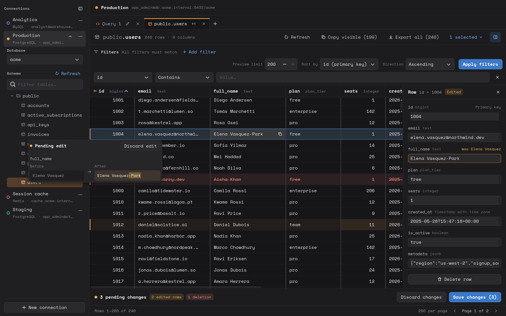
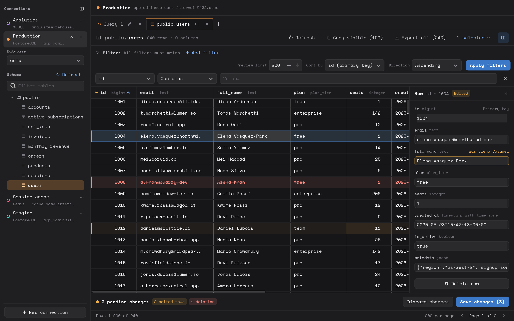
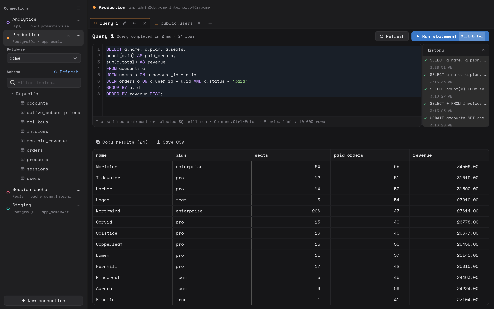
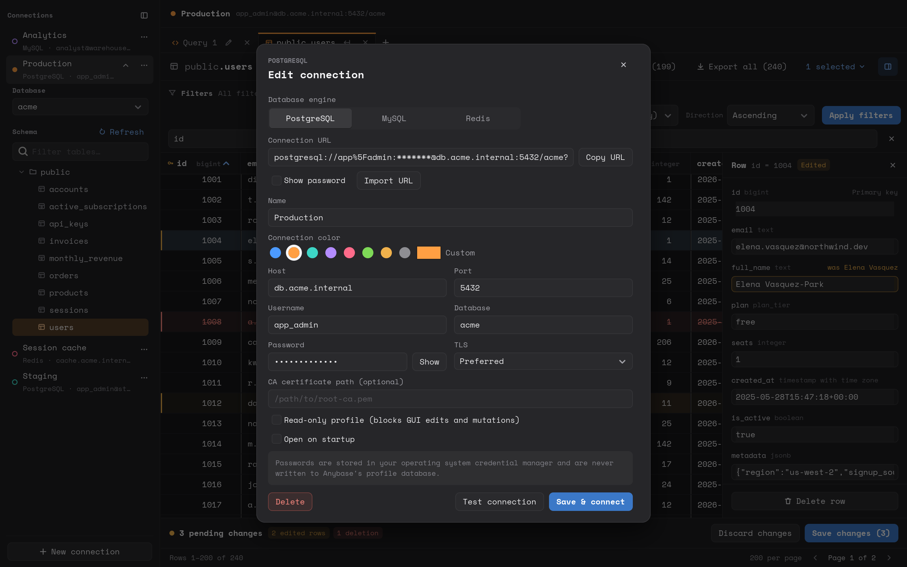
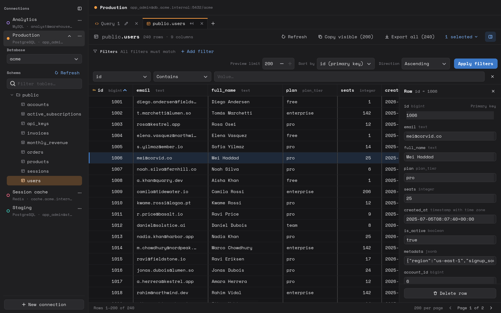

# Anybase

A fast database client for PostgreSQL, MySQL, and Redis. Native desktop apps
are released for macOS, Windows, and Linux; native Android and iPhone apps are
available for [early-access testing](#mobile-status).

**[anyba.se](https://anyba.se)** · Formerly DBM ([rename notes](docs/anybase-migration.md)).

## Download

| Platform | Direct download |
| --- | --- |
| macOS (Apple Silicon and Intel) | [Download DMG](https://github.com/joswayski/anybase/releases/latest/download/Anybase-macOS.dmg) |
| Windows (x64) | [Download installer](https://github.com/joswayski/anybase/releases/latest/download/Anybase-Windows-x64-setup.exe) |
| Linux (x86_64) | [Download AppImage](https://github.com/joswayski/anybase/releases/latest/download/Anybase-Linux-x86_64.AppImage) |

> The Windows installer is not code-signed yet, so SmartScreen may warn on
> first install. The macOS app is signed and notarized.

| | |
| --- | --- |
|  |  |
|  |  |

## Features

- Native desktop apps for macOS (AppKit), Windows (Win32/Direct2D), and Linux
  (GTK 4), with bundled Space Mono for UI, SQL, and data.
- Browse databases, schemas, tables, and Redis keys with filters, sorting, and
  CSV export.
- Edit rows safely: changes are staged, previewed, and saved together.
  PostgreSQL detects concurrent edits, and read-only profiles block writes.
- SQL and Redis workbench tabs with per-connection history.
- Color-coded connections with passwords stored in your OS credential store.
- Picks up where you left off: remembers your last database and can open
  connections on startup.
- Everything stays on your machine: no telemetry, accounts, or sync.
- Automatic signed updates with release highlights built from source changes
  (the app never sends data to generate them).

See [docs/features.md](docs/features.md) for the full feature list and what is
planned.

## Mobile status

Both native mobile apps are available as **read-only development builds**, not
public Play Store/App Store releases or desktop-parity clients.

| Platform | Availability |
| --- | --- |
| Android 8.0+ (Kotlin/Compose) | [Google Play internal testing](https://play.google.com/apps/testing/com.dbm.nativeapp) for enrolled testers, or [download the signed APK](https://github.com/joswayski/anybase/releases/download/mobile-latest/DBM-Android.apk) |
| iPhone, iOS 17+ (UIKit) | TestFlight internal testing; a tester invitation is required |

Browse PostgreSQL, MySQL, and Redis and run read-only SQL/Redis commands through
the in-process Rust core. Mobile requires verified TLS, keeps passwords only in
memory, and has no editing or exports. Physical-device and live TLS database
validation remain outstanding. See [the mobile guide](docs/mobile.md) for
release evidence, capabilities, safe networking, builds, and validation status.

## Docs

- [Development](docs/development.md): build from source, run tests, local installs
- [Releases](docs/releases.md): how releases and in-app updates work
- [Design system](docs/design-system.md): the Graphite UI
- [Native architecture](docs/native.md): the shared Rust core and native hosts
- [Mobile development clients](docs/mobile.md): Android Compose and iPhone UIKit scope
- [Anybase rename](docs/anybase-migration.md): the DBM to Anybase migration plan and the website
